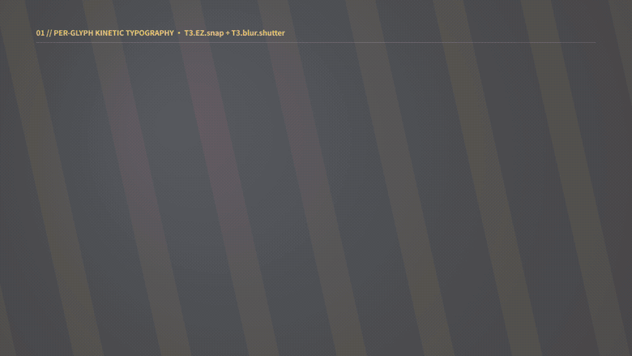
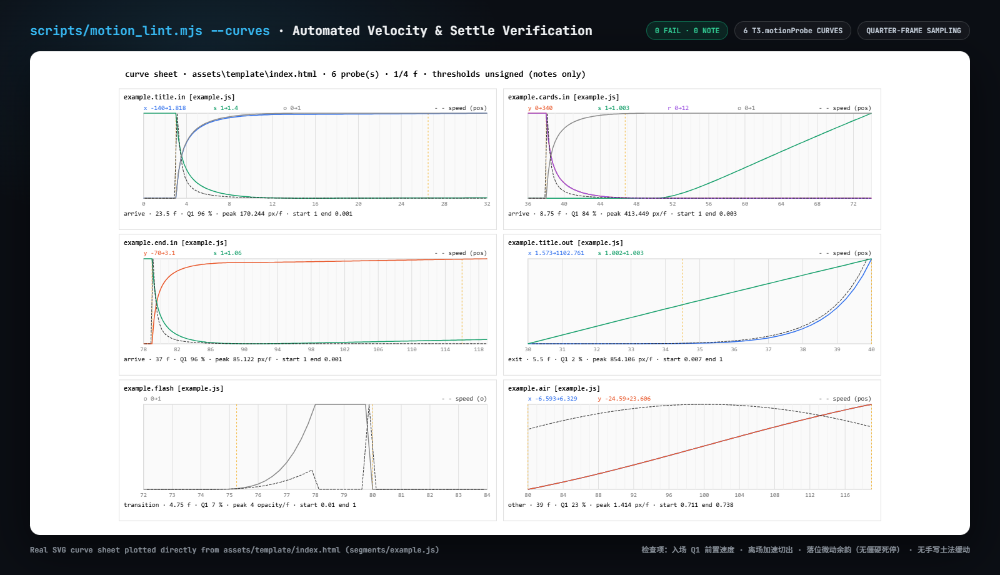
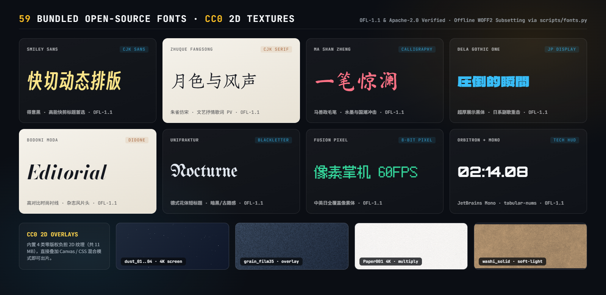
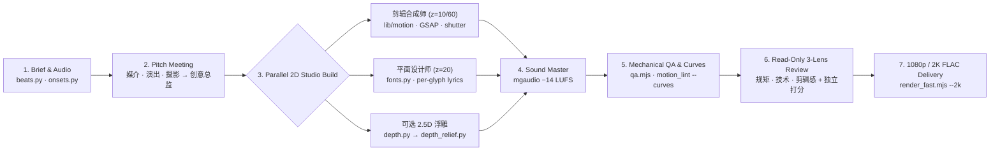

<div align="center">


<br />

[](https://github.com/qianqiucn/Chiakis-video-skill/releases)
[](LICENSE)
[](https://nodejs.org/)
[](requirements.txt)
[](assets/fonts/catalog.md)
[](assets/examples/motion/run_tests.mjs)

<h3>
  Deterministic HTML / JS / Canvas 2D Motion Graphics, Fast-Cut PV / MV &amp; Kinetic Typography Studio for AI Agents
</h3>

<p>
  面向 <b>Claude Code · Antigravity · Codex</b> 的开源 <b>2D 动效与快剪视频工作室技能</b><br />
  帧级确定性网页时间线引擎 · GSAP 3.15.1 + 动效曲线审计 · 59 套商用开源字库 · <code>mgaudio</code> 音效母带 · 可选 Blender 2.5D 深度浮雕
</p>

<p>
  <a href="#-live-motion-preview--实机渲染动效预览">🎬 Live Demo</a> ·
  <a href="#-motion-curves--typography--曲线审计与内置素材">📐 Curves &amp; Fonts</a> ·
  <a href="#-studio-architecture--工作室多工种流水线">🏗️ Architecture</a> ·
  <a href="#-quickstart--3-步快速上手">🚀 Quickstart</a> ·
  <a href="#-install-for-ai-agents--安装到-ai-代理">🧩 Install</a> ·
  <a href="#-expanding-the-font-library--按需扩展字体库">🔤 Fonts</a>
</p>

</div>

---

## 🎬 Live Motion Preview / 实机渲染动效预览

<div align="center">
  
  <br />
  <sub>
    <b>100% rendered directly by this repo's engine</b> (<code>engine.js</code> + <code>GSAP 3.15.1</code> + <code>lib/motion/*</code> + bundled fonts &amp; washi texture, 24 fps):<br />
    <b>01</b> Per-glyph kinetic slam (<code>T3.EZ.snap</code> + RGB split + 180° 5-tap <code>T3.blur.shutter</code>) →
    <b>02</b> Cushioned <b>AE Soft Bezier</b> editorial reversal (<code>Q1 = 69%</code> + <code>T3.mv.stagger</code>) →
    <b>03</b> Zero-leak <b>12 fps <code>Posterize Time</code></b> viewfinder (<code>T3.twos</code> + <code>T3.shake</code>)
  </sub>
</div>

---

## ✨ Why Chiaki's-video-skill? / 核心特性一览

<table>
  <tr>
    <td width="50%" valign="top">
      <h3>⚡ Frame-Exact 2D Timeline Engine</h3>
      Pure <code>render(t)</code> HTML/JS/Canvas 2D architecture — seek backward, render in parallel Chrome workers via <code>scripts/render_fast.mjs</code>, and pipe straight to <b>1080p / 2K BT.709 MP4</b> with zero clock drift and zero <code>npm install</code>.
    </td>
    <td width="50%" valign="top">
      <h3>📈 Curve-Verified Motion Library + GSAP 3.15</h3>
      Built-in <code>lib/motion/*</code> (<code>T3.EZ</code>, <code>T3.mv</code>, <code>T3.blur</code>, <code>T3.twos</code>, <code>T3.her</code>) + UMD <b>GSAP 3.15.1</b>. Every segment registers <code>T3.motionProbe</code> curves plotted and linted by <code>motion_lint.mjs --curves</code> so stiff eases never slip through.
    </td>
  </tr>
  <tr>
    <td width="50%" valign="top">
      <h3>🔤 59 Bundled Commercial-Safe Fonts + CC0 Textures</h3>
      Zero remote web-font failures: <b>59 OFL-1.1 / Apache-2.0 fonts</b> (47 Latin/Display/Mono/Pixel + 12 CJK/JP) and <b>9 CC0 4K dust/grain/paper/washi overlays</b> ship offline-ready, with WOFF2 subsetting &amp; 1,900+ Google Fonts on demand via <code>scripts/fonts.py</code>.
    </td>
    <td width="50%" valign="top">
      <h3>🎧 Procedural 48 kHz Audio + Optional 2.5D Relief</h3>
      Includes <b><code>mgaudio</code> (MIT)</b> for beat-locked SFX, synths, and <b>−14 LUFS / −1.1 dBTP</b> mastering with pure-synth fallback, plus optional headless <b>Blender 2.5D depth relief</b> (<code>depth.py --soften</code> → <code>depth_relief.py</code> → <code>T3.relX</code>).
    </td>
  </tr>
</table>

> **Scope / 定位说明**：专注 **2D 动效、快剪 PV/MV、动态歌词排版、MAD、可选 2.5D 插画浮雕与复刻学习**；已彻底剥离排行榜/榜单模板、重型全 3D 建模与私有绘图链路，保持仓库轻量、纯净、跨平台开箱即用。

---

## 📐 Motion Curves & Typography / 曲线审计与内置素材

### 1. Automated Velocity & Settle Verification (`scripts/motion_lint.mjs --curves`)
Static screenshots hide stiff motion. Our linter runs static rule checks (`S1–S10`) and plots every registered `T3.motionProbe` at quarter-frame resolution to verify front-loaded / AE-Bezier arrivals, accelerating exits, and living post-landing settle:

<div align="center">
  
</div>

### 2. 59 Bundled Open-Source Fonts & CC0 2D Textures (`assets/fonts/`, `assets/textures/`)
Every bundled font is verified against its internal OpenType license table (`OFL-1.1` / `Apache-2.0`) and ships with its verbatim license file and automatic end-credit generation (`scripts/fonts.py credits`):

<div align="center">
  
</div>

---

## 🏗️ Studio Architecture / 工作室多工种流水线

Instead of letting one agent improvise everything in a single pass, `Chiaki's-video-skill` enforces studio division of labor with verbatim personas (`references/personas.md`), strict file ownership (`references/crafts.md`), and physically read-only review:



---

## 🚀 Quickstart / 3 步快速上手

### 1. Prerequisites / 环境准备
- **Node.js ≥ 22**（内置 `fetch` + `WebSocket`，无需 `npm install`）
- **Chrome / Chromium / Edge**（Windows / macOS / Linux 自动探测，也可用 `CHIAKI_CHROME` 指定）
- **Python ≥ 3.10** + 依赖（含 `imageio-ffmpeg`，无需单独配置 FFmpeg）：

```bash
git clone https://github.com/qianqiucn/Chiakis-video-skill.git
cd Chiakis-video-skill

# Recommended: isolated virtual environment
python -m venv .venv
# Windows PowerShell: .venv\Scripts\Activate.ps1   |   macOS / Linux: source .venv/bin/activate
pip install -r requirements.txt
```

### 2. One-Command Doctor & Self-Test / 一键体检与自测
```bash
python -X utf8 scripts/doctor.py                          # Check Node >=22, Chrome, FFmpeg, Blender, deps & fonts
python -X utf8 scripts/skill_check.py                     # Verify 13 manuals, 56 motion IDs, workflows & hygiene
node assets/examples/motion/run_tests.mjs                 # Run all 8 motion unit test suites (174 assertions)
node scripts/motion_lint.mjs assets/template/index.html   # Lint the starter 2D template
```

### 3. Render the Included 5-Second Demo / 渲染内置 5 秒样片
```bash
# Contact sheet preview (fast)
python -X utf8 scripts/run_queue.py web --lane demo -- node scripts/snap.mjs assets/template/index.html out/snaps "0-119:10" --sheet preview

# Full 1080p + 720p MP4 render
python -X utf8 scripts/run_queue.py web --lane demo -- node scripts/render_fast.mjs assets/template/index.html 0 5 out/demo.mp4

# Static + runtime motion lint + SVG curve sheet
python -X utf8 scripts/run_queue.py web --lane demo -- node scripts/motion_lint.mjs assets/template/index.html --curves
```

---

## 🧩 Install for AI Agents / 安装到 AI 代理

| Platform | How to Install | Notes |
|---|---|---|
| **Claude Code** | `cp -r Chiakis-video-skill ~/.claude/skills/chiakis-video-skill` | Root `SKILL.md` discovered automatically |
| **Codex** | `cp -r Chiakis-video-skill ~/.codex/skills/chiakis-video-skill` | Root `SKILL.md` discovered automatically |
| **Antigravity (Plugin)** | `python -X utf8 scripts/install_agy_plugin.py` | Stages `skills/chiakis-video-skill/SKILL.md`, `rules/AGENTS.md`, `agents/`, and resolved `hooks.json` guardrail (`--dry-run` supported) |
| **claude.ai / `.skill` zip** | Download from [GitHub Releases](https://github.com/qianqiucn/Chiakis-video-skill/releases) or run `python -X utf8 scripts/pack_skill.py --lite` | `--lite` produces a `≤ 200`-file archive (`~0.6 MB`); fetch fonts on demand via `scripts/fonts.py` |

---

## 🔤 Expanding the Font Library / 按需扩展字体库

To keep `git clone` fast and stay comfortably within GitHub limits, the repository bundles **59 high-frequency OFL-1.1 / Apache-2.0 families (~99 MB)** rather than the full ~2.2 GB Google Fonts mirror (~1,960 families). Fetch any additional commercial-safe font on demand with automatic OpenType license verification:

```bash
# Search the bundled offline library (59 families, instant)
python -X utf8 scripts/fonts.py search --local --group cjk-serif

# Search online across 1,900+ Google Fonts + Fontsource + curated GitHub CJK fonts
python -X utf8 scripts/fonts.py search "WenKai"

# Download specific families (e.g. LXGW WenKai, Shippori Mincho B1) into assets/fonts/
python -X utf8 scripts/fonts.py get "LXGW WenKai" "Shippori Mincho B1"

# Download all remaining families from the 68-family curated starter shelf (+~128 MB)
python -X utf8 scripts/fonts.py get starter

# Optional: mirror all ~1,960 Google Fonts locally (~2.2 GB; preview size first with --estimate)
python -X utf8 scripts/fonts.py get --all-google --estimate
python -X utf8 scripts/fonts.py get --all-google --jobs 4

# Pack subset WOFF2 + Base64 fonts into a video project (100% offline, zero remote web fonts)
python -X utf8 scripts/fonts.py use <project_dir> "Smiley Sans" "Bodoni Moda" "JetBrains Mono"
```

> Tip: set `CHIAKI_FONTS=/path/to/your/fonts` to keep a large shared font library outside the repo.

---

## 📚 Documentation & Configuration / 完整目录与环境变量

<details>
<summary><b>📖 13 Studio Craft Manuals (<code>references/</code>)</b> — click to expand</summary>

| File | Focus |
|---|---|
| [`house-style.md`](references/house-style.md) | Creative brief, fixed goals vs breakable defaults, studio hierarchy |
| [`style-grammar.md`](references/style-grammar.md) | Beat grids, 7 Canvas PV transition families, hype / MAD / AE soft Bezier curves, 2D hair/veil staging, exact `Posterize Time` stepping |
| [`motion-library.md`](references/motion-library.md) | 56 indexed motion IDs (`LIB` / `EXISTING` / `PROSE`), motion sheets & SVG curve-sheet workflow |
| [`graphic-design.md`](references/graphic-design.md) | Title builds, per-glyph kinetic lyrics, local font selection, 5-layer framing, tagline cards |
| [`relief-25d.md`](references/relief-25d.md) | Optional Blender 2.5D depth relief (`depth.py --soften` → `depth_relief.py` → `T3.relX` + `parallax.py`) |
| [`mg-styles.md`](references/mg-styles.md) | 14 pure 2D / 2.5D motion-design visual forms with checkable signature techniques |
| [`shot-recipes.md`](references/shot-recipes.md) | 124 named motion-design shot recipes (`video-shotcraft`, Apache-2.0) |
| [`script-writing.md`](references/script-writing.md) | Pitch meeting format, genre matching, shot table & cut motivation |
| [`quality-bar.md`](references/quality-bar.md) | Gate A / B1 / B2, independent 7-dimension scorecard, 2D troubleshooting table |
| [`crafts.md`](references/crafts.md) | Strict craft ownership boundaries (`Edit`, `Design`, `Sound`, `Review`) |
| [`personas.md`](references/personas.md) | Verbatim studio personas for multi-agent prompt injection |
| [`build-brief.md`](references/build-brief.md) | Ready-to-fill builder brief template |
| [`production.md`](references/production.md) | Cross-platform CLI toolkit, render queue, 2K FLAC delivery, Canvas 2D pitfalls |

</details>

<details>
<summary><b>📂 Repository Structure / 仓库目录结构</b> — click to expand</summary>

```text
Chiakis-video-skill/
├── SKILL.md                    # Agent entrypoint & 7-step 2D video studio pipeline
├── README.md                   # This guide
├── LICENSE                     # MIT License
├── THIRD_PARTY_NOTICES.md      # GSAP, mg-styles-15, video-shotcraft, OFL/Apache fonts
├── docs/                       # Visual banner, live 24fps demo.gif, curve sheet & font specimen
├── references/                 # 13 studio craft manuals
├── scripts/                    # Cross-platform render, QA, lint, audio/video analysis, fonts, doctor, queue
│   ├── blender/                # Optional headless Blender 2.5D depth_relief.py
│   └── vision/                 # Optional Depth Anything V2 (depth.py) & parallax.py
├── assets/
│   ├── template/               # engine.js, index.html, GSAP 3.15.1, lib/motion/*, 2D/2.5D helpers
│   ├── examples/               # 8 motion unit test suites (174 assertions) & demos
│   ├── fonts/                  # 59 bundled OFL-1.1/Apache-2.0 fonts + catalog.json + catalog.md
│   ├── mgaudio/                # MIT 48 kHz procedural SFX, synth & -14 LUFS mastering engine
│   ├── textures/               # CC0 4K dust, film grain, paper, washi 2D overlays
│   ├── workflows/              # JS studio workflows (pitch, build, review_fix, briefs)
│   └── workflows_agy/          # Antigravity Python run_workflow scripts
├── rules/                      # Always-on studio division-of-labor rule (AGENTS.md)
├── hooks/                      # Optional PreToolUse guardrail (chiaki_guard.py)
└── agents/                     # Scoped subagent definitions (writer, builder, reviewer)
```

</details>

<details>
<summary><b>🔧 Optional Environment Variables (<code>CHIAKI_*</code>)</b> — click to expand</summary>

| Variable | Default | Purpose |
|---|---|---|
| `CHIAKI_CHROME` | Auto-detected Chrome / Chromium / Edge | Browser binary for headless CDP rendering |
| `CHIAKI_FFMPEG` | `ffmpeg` on `PATH` or `imageio-ffmpeg` | FFmpeg executable path |
| `CHIAKI_BLENDER` | Auto-detected Blender (optional) | Blender binary for `scripts/blender/depth_relief.py` |
| `CHIAKI_FONTS` | `<repo>/assets/fonts` | Custom local font library directory |
| `CHIAKI_QUEUE_DIR` | `<tempdir>/chiaki_video_queue` | Shared render queue lock directory |
| `CHIAKI_WEB_SLOTS` | `1` | Max simultaneous headless-Chrome jobs |
| `CHIAKI_BLENDER_SLOTS` | `2` | Max simultaneous headless-Blender jobs |
| `CHIAKI_MAX_WORKERS` | `2` | Max Chrome render workers per job |
| `FREESOUND_API_KEY` | `~/.config/chiaki-video/freesound_api_key.txt` | Optional Freesound API key for recorded real-world SFX |

</details>

---

## 📜 License & Credits / 开源协议与致谢

Original skill docs, templates, workflows, and scripts are released under the **[MIT License](LICENSE)**.  
Bundled third-party components (`GSAP 3.15.1`, `mg-styles-15` MIT, `video-shotcraft` Apache-2.0, 59 `OFL-1.1` / `Apache-2.0` fonts, and CC0 textures) retain their original licenses — see **[THIRD_PARTY_NOTICES.md](THIRD_PARTY_NOTICES.md)**.
