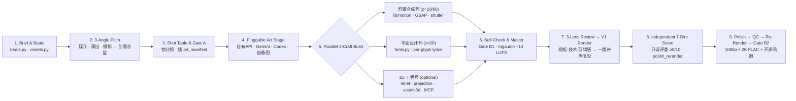

<div align="center">


<br />

[](https://github.com/qianqiucn/Chiakis-video-skill/releases)
[](LICENSE)
[](https://nodejs.org/)
[](requirements.txt)
[](#-blender--blender-mcp-小白安装配置指南-optional-flagship-3d)
[](#)
[](assets/fonts/catalog.md)
[](assets/examples/motion/run_tests.mjs)

<h3>
  Flagship Deterministic 2D + Three.js Stylized Graphic-3D + Blender Cinematic 3D Motion Graphics, Fast-Cut PV / MV &amp; Kinetic Typography Studio for AI Agents
</h3>

<p>
  面向 <b>Claude Code · Antigravity · Codex</b> 的旗舰级 <b>2D + Three.js 风格化 3D + Blender 电影级 3D 双引擎动效与快剪视频工作室技能</b><br />
  帧级确定性网页时间线 · 内置 Three.js 真 3D 挤出中/日/英立体字/Z 夹心歌词环/实时色散棱镜/3D 百叶窗 · GSAP 3.15.1 + 动效曲线审计 · 59 套商用开源字库 · <code>mgaudio</code> 音效母带 · 满血 Blender 浮雕/投影/搭景/免费 3D 素材库 &amp; MCP 实时调光
</p>

<p>
  <a href="#-live-motion-preview--实机渲染动效预览">🎬 Live Demo</a> ·
  <a href="#-motion-curves--typography--曲线审计与内置素材">📐 Curves &amp; Fonts</a> ·
  <a href="#-studio-architecture--13-步旗舰流水线">🏗️ 13-Stage Pipeline</a> ·
  <a href="#-quickstart--3-步快速上手">🚀 Quickstart</a> ·
  <a href="#-install--unified-chiaki-command--一键安装与-chiaki-总指令">🧩 Install &amp; /chiaki</a> ·
  <a href="docs/PROMPT_TEMPLATE.md">📋 Copy-Paste Prompt</a> ·
  <a href="#-blender--blender-mcp-小白安装配置指南-optional-flagship-3d">🧊 Blender &amp; MCP 小白教程</a>
</p>

</div>

---

## 🎬 Live Motion Preview / 实机渲染动效预览

<div align="center">
  
  <br />
  <sub>
    <b>100% rendered directly by this repo's engine</b> (<code>engine.js</code> + <code>GSAP 3.15.1</code> + <code>lib/motion/*</code> + bundled fonts &amp; washi texture, 24 fps):<br />
    <b>01</b> Per-glyph kinetic slam (<code>T3.EZ.snap</code> + RGB split + 180° 5-tap <code>T3.blur.shutter</code>) →
    <b>02</b> Cushioned <b>AE Soft Bezier</b> editorial reversal (<code>Q1 = 69%</code> + <code>T3.mv.stagger</code>) →
    <b>03</b> Zero-leak <b>12 fps <code>Posterize Time</code></b> viewfinder (<code>T3.twos</code> + <code>T3.shake</code>)
  </sub>
</div>

---

## ✨ Why Chiaki's-video-skill? / 核心特性一览

<table>
  <tr>
    <td width="50%" valign="top">
      <h3>⚡ Frame-Exact 2D Timeline Engine</h3>
      Pure <code>render(t)</code> HTML/JS/Canvas 2D architecture — seek backward, render in parallel Chrome workers via <code>scripts/render_fast.mjs</code>, and pipe straight to <b>1080p / 2K BT.709 MP4</b> with zero clock drift and zero <code>npm install</code>.
    </td>
    <td width="50%" valign="top">
      <h3>📈 Curve-Verified Motion Library + GSAP 3.15</h3>
      Built-in <code>lib/motion/*</code> (<code>T3.EZ</code>, <code>T3.mv</code>, <code>T3.blur</code>, <code>T3.twos</code>, <code>T3.her</code>) + UMD <b>GSAP 3.15.1</b>. Every segment registers <code>T3.motionProbe</code> curves plotted and linted by <code>motion_lint.mjs --curves</code> so stiff eases never slip through.
    </td>
  </tr>
  <tr>
    <td width="50%" valign="top">
      <h3>🧊 Dual-3D Flagship: Three.js Graphic-3D + Blender 3D</h3>
      <b>Two co-starring 3D engines, freely selectable per film:</b> bundled offline <b>Three.js r160 (MIT) + <code>lib/three_kit.js</code> + <code>fonts.py glyph3d</code></b> brings true 3D extruded CJK/JP/Latin typography (<code>flat</code>/<code>toon</code>+ink/<code>glass</code>/<code>wire</code>), character Z-sandwich 360° lyric rings, 3D typography corridors, live chromatic glass prisms, and <code>z=60</code> 3D louver transitions directly into 2D PVs; paired with <b>Blender 2.5D relief</b>, <b>camera projection</b>, <b>built sets &amp; cel shading</b>, <b>4 free 3D libraries</b>, and <b>live Blender MCP look-dev</b>.
    </td>
    <td width="50%" valign="top">
      <h3>🔤 59 Bundled Fonts · CC0 Textures · <code>mgaudio</code></h3>
      Zero remote web-font failures: <b>59 OFL-1.1 / Apache-2.0 fonts</b> (47 Latin/Display/Mono/Pixel + 12 CJK/JP), <b>9 CC0 4K dust/grain/paper/washi overlays</b>, and <b><code>mgaudio</code> (MIT)</b> for beat-locked 48 kHz SFX and <b>−14 LUFS / −1.1 dBTP</b> mastering.
    </td>
  </tr>
</table>

> **Flagship Scope / 旗舰定位说明**：面向 **原创 2D + Three.js 风格化 3D + Blender 电影级 3D 动效、快剪 PV/MV、动态歌词排版、品牌片头、MAD 与复刻学习** 的全流程制片技能。Three.js 与 Blender 并列旗舰品质硬性规格，用户可在需求表自由选择（`全能双 3D 旗舰` / `Three.js 风格化 3D` / `Blender 电影级 3D` / `纯 2D`）。
>
> **✨ What's New in `v1.10.0`（面向 Pro 用户的「开片额度档位路由」三档工作流 `Lite` / `Pro` / `Ultra` + 4 项零损画质省额优化）**：
> - **每次开新片先问额度档位，自动匹配对应工作流（`memory.py tier` 记住上次推荐项）**：安装插件后每次执行 `/chiaki` 开新片（若首句未显式指定）都会先做 1 秒单选确认，并一行报出本档精确子代理与 `pro` 调用预算：
>   - **`Lite` 极简省额流（省 ~85% 额度 · 4 幕仅 ~6–8 代理 / 2–3 `pro`）**：主线程直接出 2 个方向简案秒选 → 1 幕 1 全栈单画布（副歌 `pro` / 过渡 `flash`）→ 成曲主线程脚本直出 `-14 LUFS` 母带 → 直出 V1 带声片 → 1 名物理只读 `pro` 综合审片评分 → 原代理热修 1 轮 → 重渲定稿；
>   - **`Pro` 均衡主力流（Pro / Plus 默认推荐 · 省 ~70–75% 额度 · 4 幕仅 ~10–14 代理 / 4–6 `pro`）**：主线程直接出 2–3 套跨幕方向简案拍板（`0` 提案代理）→ 中长片先打穿 10–16 s 样板 → 1 幕 1 全栈单画布（`build.py`/`build.js` `tier="pro"`，真需 Blender 3D 才按幕挂 `flash` 3D 师，跳过幕内 Dailies/QC）→ **合并 Stage 9 + Stage 11**（直出 V1 后 1 名物理只读 `pro` 独立 7 维评委看带声片出单 → 原代理热修 1 轮 → 1 名物理只读 `flash` QC 复验 → 重渲 2K FLAC）；
>   - **`Ultra` 满血旗舰流（Max / Ultra）**：完整 13 步旗舰工作室（每幕 3 路盲写提案会 + 三工种分拆 + Dailies + Stage 9 三视角三复核 + Stage 11–13 独立评分与多轮精修）。
> - **4 项三档通用的零损省额底盘升级**：① 每幕简报内置 **20 行浓缩工艺卡**（动效 ID 白名单 + 色板 + 帧界）替代每个子代理冷读 6 本大文档；② 精修优先 **原制作代理热修**（`send_message` / Swarm 复用上下文）替代冷启动新修改员；③ `stem_sync.py` / `motion_lint --curves` / `qa.mjs` / `visual_metrics.py` 全量本地 0 额度拦截硬伤再进 `pro` 审片；④ 按幕重要性分配 `pro` / `flash` 权重，**同时死守底线（绝不自审、绝不跳过本地音轨/曲线硬检、完片必出偏好复盘卡）**。
>
> **✨ What's New in `v1.9.1`（Stage 1 给完歌自动判别有无唱词 `has_vocals` + 自动复用同级 Whisper 缓存）**：
> - **`scripts/stem_sync.py` 自动判定 `vocal_song` vs `instrumental`**：拿到任何外部音乐文件，Stage 1 第一件事统一先跑 `stem_sync.py`——拆轨后自动检测 `vocals.wav` 有效活跃时长/占比与峰值，**检出人声**则走双轨分离卡鼓+卡字；**若为纯器乐（`has_vocals: false`）**则自动跳过空干声切片、声谱图与 Whisper，直接切纯音乐鼓点模式，零误判也不浪费时间；同步支持 `CHIAKI_WHISPER_MODELS` 及自动探测 `<model-dir>/../whisper_models` 复用本地权重。
>
> **✨ What's New in `v1.9.0`（Stage 1 人音双轨分离卡点引擎 `scripts/stem_sync.py` + 安装器内置分人声与逐字对齐依赖）**：
> - **新增 `scripts/stem_sync.py`（Stage 1 开剪前先分人声与伴奏，双轨分别锁鼓点与歌词）**：
>   - **一刀分离、双倍精度**：自动调用本地 **`audio-separator`**（默认 SOTA `vocals_mel_band_roformer.ckpt`，`--fast` 可切 60 MB 轻量 ONNX `UVR-MDX-NET-Inst_HQ_3.onnx`；亦兼容 `demucs` 与独立环境 `CHIAKI_STEM_PYTHON`）将原曲拆成 **`vocals.wav`**（纯净干人声）与 **`instrumental.wav`**（纯净伴奏）；
>   - **纯伴奏精准抓鼓 + 局部 BPM 漂移检测（`kick_grid.json`）**：消除人声齿音对宽带通量的污染，自动按 30 s 窗口实测各段局部 BPM 与全局网格偏差，开剪前就抓出副歌/终副歌微速漂移（不再死套一条常量公式导致中后段脱拍）；
>   - **纯干人声零污染锁字（`vocal_phrases.json` + `vocal_charts/dry_*.wav/.png` + 可选 `--whisper`）**：在绝对静音背景上提取分句起止与 `180–4500 Hz` 音节起音峰，输出干声微切片（Gemini 原生直听）与无伴奏污染声谱图（Claude/Codex）；开启 `--whisper --lyrics <txt>` 时经 FFmpeg 直喂 16 kHz float32 给 `faster-whisper`（绕过 PyAV 兼容性坑）并与干声起音峰交叉吸附，自动标出前导气口静音段。
> - **依赖安装器与体检同步集成（`scripts/setup_env.py`、`scripts/doctor.py`）**：
>   - `setup_env.py` 在 `2d` / `3d` / `full` 档位默认随核心依赖一起安装 **`audio-separator[gpu|cpu]` + `faster-whisper`**（自动检测 NVIDIA GPU 先装 CUDA PyTorch，支持 `--stem-models` 指定非 C 盘模型缓存、`--stem-python` 复用已有分人声环境，以及 `--no-stems` 极简跳过）；
>   - `doctor.py` 新增 `Vocal/Drum Stem Sync` 体检项；`rules/AGENTS.md` §3、`SKILL.md` Stage 0/1、`commands/chiaki/SKILL.md` 与 `references/production.md` §3 全面升级为「成曲 PV 开剪前先分人声/伴奏双轨测量」。
>
> **✨ What's New in `v1.8.3`（Gemini / AGY 专属 Swarm 总导演指挥手册 · Claude Opus 豁免）**：
> - **沉淀 Swarm 多工协同实操规范（`rules/AGENTS.md` §4 + `references/production.md` §7，仅限 Gemini / AGY 会话，Claude Opus 完全豁免）**：将实战验证有效的总导演编排方法固化为 5 条可执行纪律——
>   - **大改先 `kill` 清上下文 + 精简单画布编队**：跨版本重做先 `kill` 旧编队清干净旧习惯记忆；动态歌词 PV 优先「1 幕 1 全栈强模型单画布」（并发 ≤ 5），减少幕内跨工种内耗；
>   - **4 件硬基建先行 + 底座独占**：开 Swarm 前先落签字样板、总导演独占共享世界库、分幕独立预览 HTML 与 `visual_metrics.py` 尺子；工人回报音频实测帧号勘误时总导演即时同步更新共享骨架；
>   - **两段门禁跨幕查重 + 纯函数预调用接缝契约**：审 `[storyboard]` 时横向比对平行幕（如副歌 1/2/终）在写第一行代码前打回撞车物件与旧模板复发；提前锁死入幕纯函数 `open.actN(ctx, f)` 提前 `8–12 f` 无副作用预调用协议，引导相邻工人点对点对齐；
>   - **集中出图 + 占位零阻塞 + 验图拦截与像素级使用说明书**：严禁 Swarm 工人私调生图 API（分镜提交 `≤ 4` 张/幕清单，总导演后台出图、工人先用占位写逻辑）；不合格立即公屏截停防误用；合格交图必附 1 行朝向、安全裁切、手部尺寸上限与借位动效说明；
>   - **3–6 行极简去情绪公屏风气**：`@coordinator` 看板发言只写结论、具体帧号/像素参数与下一步动作，禁用感叹号堆砌与彩虹屁，带动下游工人以实测数字回报。
>
> **✨ What's New in `v1.8.2`（`lib/look_fx.js` 逐镜材质/印刷着色/实拍遮罩/OKLCH 走色零件库 + Gemini/AGY「零件军火库」法则）**：
> - **新增 `assets/template/lib/look_fx.js`（`T3.look.*`，零依赖纯净 Canvas 2D）**：把实拍水墨转场、逐镜材质、二次印刷着色与 OKLCH 走色沉淀为开箱即用零件——
>   - **`T3.look.coat(ctx, f, { paper, grain, dust, scanline, faceGuard })`**：逐镜按需开关纸纹/颗粒/尘埃/扫描线（暗场/黑胶镜关纸纹保实黑、近景人脸可开 `faceGuard`），取代「全片硬蒙一层 `z=45` `multiply` 灰膜」；
>   - **`T3.look.bakePrint(img, h)` + `T3.look.drawPrint(ctx, B, mode, opts)`（`fx.print-plate`）**：一次缓存烘焙 6 种高反差印刷处理（`screen` 60° 线网 / `dots` 双色半调网点 / `neg` 黑底负片 / `sil` 双版剪影 / `two` 错版叠印 / `key` 墨线），告别 3 分钟裸贴同一质感原图；
>   - **`T3.look.lumaMatte(ctx, fromSrc, toSrc, maskImg, opts)`（`trans.luma-matte`）**：把 `media_lib.py` 下载的 4K 实拍水墨/烟雾/烧片直接变成真实亮度遮罩转场，不再只挂背景飘淡烟；
>   - **`T3.look.okMix(hexA, hexB, k, hintHex, bump)`（`trans.ground-walk` 从 `Pending` 正式转正）**：切镜前 2–4 帧 OKLCH 色相顺滑走色（端点精确锁色零跳变），杜绝 RGB 线性插值发灰；
>   - **`T3.look.monoSpline(keys)` + `T3.look.framed(...)`**：带 Fritsch–Carlson 单调钳制的逐字起唱样条与带自动过扫的持续微推画幅。
> - **拆除文档诱导死板的旧约束 + 补齐 Gemini/AGY 第 7 条法则**：更新 `graphic-design.md` §8、`art-pipeline.md` §4、`SKILL.md` 与 `motion-library.md`（66 条 `0 FAIL / 0 NOTE`）；在 `rules/AGENTS.md` §5（**仅限 Gemini / AGY，Claude Opus 豁免**）新增「零件军火库思维」——不服务母题的工具主动弃用是加分项、实拍素材优先当因果遮罩用、高速运镜调用真时间快门 `T3.blur.shutter` 禁画假速度线；`scripts/visual_metrics.py` 同步补齐无 `ffprobe` 时的 24/30 fps 自动探测。
>
> **✨ What's New in `v1.8.1`（Gemini / AGY 宿主专属导演与审美纪律 + 像素/运动波形量化体检 + Canvas 文本报错拦截）**：
> - **Gemini / Antigravity（AGY）专属 6 条导演与审美护栏（`rules/AGENTS.md` §5 · Claude Opus 完全豁免）**：仅面向 Gemini 系列模型与 AGY 默认会话补齐工程与审美防呆——① > 30 s 中长片强制先打穿 **10–16 s Gate A 黄金样板**再铺全片；② Swarm 开工前先落共享视觉着色/世界坐标引擎，工人须先交「因为…所以…」因果分镜 + 相邻三换矩阵再写代码；③ 锁 1 根单核视觉物理主线，严禁对工具箱集邮打卡或四角堆静态装饰；④ 动态歌词 PV 允许单幕单画布融合「世界物件 + 文字」，禁用凭空 `alpha → 0` 淡出；⑤ 验图走五指/地标/透明黑块挑错清单；⑥ 汇报只写事实与实测数字，禁用「完美/彻底/100%」等乐观自夸词。
> - **像素与运动密度量化体检（`scripts/visual_metrics.py`）**：零额外依赖（`ffmpeg` + `numpy` + `Pillow`），一键输出饱和度均值 `sat_mean`（防发灰褪色）、实黑占比 `true_black_pct`（仅统计全通道低亮真黑、不误算高饱蓝/红）、逐帧运动 `MAD` 均值与 `still_ratio`、> 2.0 s 低动量停留告警，以及纯 Pillow 生成的 `motion_wave.png` 波形图（支持 `--ref` 双轨对标）。
> - **Canvas `NaN`/`undefined` 文本审计升级（`scripts/qa.mjs`）**：Stage 2 文本巡检同时拦截 DOM 文本节点与 Canvas `fillText` / `strokeText`，根治画布内隐蔽的 `MASTER BPM: undefined` / `-0NaN` 漏网问题。
>
> **✨ What's New in `v1.8.0`（双 3D 旗舰架构：Three.js 风格化 3D 字/场景工具链 × Blender 电影级 3D + 完片强制偏好复盘卡）**：
> - **离线内置 Three.js r160（MIT）+ `lib/three_kit.js` 风格化图形 3D 工具箱**：单一共享 `WebGLRenderer`（`NoToneMapping` + `SRGBColorSpace` 零色偏、不爆 Chrome 上下文），完整提供 8 大 2D 原生质感 3D 原语 —— **`extrudeText`**（`flat`/`toon`+黑描边/`glass`/`wire` 真 3D 立体字）、**`textRing`**（角色 Z 夹心 `drawBack`/`drawFront` 360° 歌词环，自动测宽防叠字）、**`textCorridor`**（3D 歌词海报走廊，内置 `maxWidth` 防越界）、**`prismOverlay`**（实时色散玻璃棱镜折穿 2D 画面）、**`louverTransition`**（`z=60` 真透视 3D 百叶窗翻转转场）、**`field`**（风格化 3D 地平线网格与建筑方柱）、**`relief`**（免 Blender GPU 深度浮雕）与 **`stage`**（2D 抠图真 Z 舞台），并全部注册进 `references/motion-library.md`（64 条 `0 FAIL / 0 NOTE`）。
> - **离线中/日/英真 3D 矢量字形提取（`scripts/fonts.py glyph3d`）**：基于 `fontTools` + `skia-pathops` 仅抽取本片用到的标题/歌词字符并自动合并可变字重笔画，生成 4–60 KB 离线 `assets/fonts/glyph3d.js`（比 15 MB 传统 Three.js 字体 JSON 小千倍以上），`lib/three_kit.js` 自动判定 TTF/OTF 环绕方向保证中文字内孔（如「星」「破」「晓」）零反转。
> - **双 3D 旗舰自由选择（`docs/PROMPT_TEMPLATE.md`、`references/3d.md` §5e、`house-style.md`、`crafts.md`）**：明确 Three.js（2D 原生风格化图形/文字/棱镜/转场 3D）与 Blender（写实/光影/光学景深/实景搭景/相机投影 3D）并列旗舰硬指标，**即便是已安装 Blender 的用户默认「全能双 3D 旗舰」也会让两套引擎同片共演**；支持 GPU（实测 1080p 24fps 实时输出）与 `CHIAKI_CPU=1` 无独显软渲染兜底。
> - **Gate B2 强制「完片偏好复盘卡」（`scripts/memory.py draft-card`）**：针对真实用户反馈「做完片后未主动询问审美偏好」，新增 `memory.py draft-card` 子命令并将其写入 `quality-bar.md` Gate B2 第 6 项、`rules/AGENTS.md` 阶段 5、`commands/chiaki/SKILL.md` 与 `SKILL.md` Stage 13 —— 只要记忆模式不是 `off`/`readonly`，每次终片交付末尾**强制附上 10 秒 3 问「🧠 下支片想怎么更合你胃口？」偏好提问与候选记忆卡**。
>
> **✨ What's New in `v1.7.1`（长序列渲染防卡死 & 质检提速 + 评审防截断 + Antigravity Swarm 混合编排）**：
> - **渲染与 CDP 防停滞内核（`scripts/_cdp.mjs`、`scripts/render_fast.mjs`）**：给 CDP 全链路补上超时/断连立即失败与双 `rAF` 兜底；新增分 worker 实时阶段心跳、单帧超时自动重启 Chrome 并回落软件绘制、无进度看门狗（`--stall-timeout`）自动释放队列槽位、`.part.mp4` 原子落盘防毁旧片，以及 **`--patch-frames` / `--encode-only`** 局部重渲免全片重导出。
> - **质检秒级提速与增量落盘（`scripts/qa.mjs`）**：移除文本审计阶段冗余的 120 次全屏截屏改用纯 `seekOnly`，拆成 5 个带计时日志阶段并逐阶段增量刷写 `qa_report.txt` + `qa_state.json`，彻底解决长序列 500s 超时与丢指标问题。
> - **独立评审防截断 / 503 恢复（`score_brief.md`、`polish_rerender`）**：结构化 7 维 JSON 评分块 + `Verdict` 前置回复顶部，末尾强制 `<!-- SCORE_COMPLETE -->`，按 `taskId` 拆分落盘 `work/score_<id>.json/.md`，缺失维度或遭截断时显式标 `INCOMPLETE_REVIEW` 阻断误通过。
> - **零缺包音频导出 & 工具防呆（`mgaudio`、`snap_clean.mjs`、`look.py`、`doctor.py`）**：`mgaudio` 内置纯 `scipy` BS.1770-4 LUFS 与纯 Pillow 声谱图兜底（缺 `pyloudnorm`/`matplotlib` 亦不中断导出，并补全 `requirements.txt`）；`snap_clean.mjs` 兼容单帧/帧列表与 `--fps` 并附三模式示例；修复 `look.py video` 缺失 `import glob`；`doctor.py` 清晰区分 `[REQ]` / `[OPT]`；新增 **Antigravity Swarm（`/teamwork`）混合编排规范与钩子护栏**及全宿主审片能力声明。
>
> **✨ What's New in `v1.7.0`（工作室自迭代记忆 + 在线免 Key 质感/实拍素材库 + 19 类二次元部位 2K 精拆）**：
> - **外置自迭代记忆系统（`scripts/memory.py`）**：默认存 `~/.chiaki-studio/`（独立于 Skill 仓库、升级永不丢失且三端共享），支持四态开关 **`ask` / `auto` / `readonly` / `off`** 与 `/chiaki memory`，沉淀长期审美偏好、去重避坑规矩（复发 `hits >= 2` 自动标星提示升级 Skill 本体）与作品履历（提案会跨片防撞型）；`docs/PROMPT_TEMPLATE.md` 同步新增**自查精修轮数**（0 / 1 / 2+ 轮）与**自迭代记忆开关**。
> - **在线免 Key 质感层 & 实拍素材库（`scripts/media_lib.py`）**：装上即可免 Key 自动搜索挑拣并下载 **ambientCG（2,000+ CC0 2K 纸纹/划痕/表面瑕疵）+ Poly Haven（870+ CC0 质感贴图）+ Internet Archive（4K 水墨/烟雾/烧片/延时实拍）+ NASA 实拍**（并支持可选免费 `PEXELS_API_KEY` / `PIXABAY_API_KEY` 与本地库 `CHIAKI_FOOTAGE_DIR`），自动联动 `prep_texture.py` 拉伸纤维、自动用 FFmpeg 拆成 `T3.sequence` 序列帧并输出版权鸣谢。
> - **视觉抠图与旗舰标杆**：零外部依赖的 **`scripts/vision/part_cutout.py`**（19 类动漫部位 2K 精拆 + `--clean-plate` 外背景去重影）、纯 MIT **`cutout.py`**（`setup_env.py --profile full` 自动检测 N 卡装 CUDA `cu128` PyTorch + `--hf-home`）、旗舰质量量化标杆 **`references/benchmark-quality.md`** 与 **`rules/AGENTS.md` §3 宿主多模态死规矩**。

---

## 📐 Motion Curves & Typography / 曲线审计与内置素材

### 1. Automated Velocity & Settle Verification (`scripts/motion_lint.mjs --curves`)
Static screenshots hide stiff motion. Our linter runs static rule checks (`S1–S10`) and plots every registered `T3.motionProbe` at quarter-frame resolution to verify front-loaded / AE-Bezier arrivals, accelerating exits, and living post-landing settle:

<div align="center">
  
</div>

### 2. 59 Bundled Open-Source Fonts & CC0 2D Textures (`assets/fonts/`, `assets/textures/`)
Every bundled font is verified against its internal OpenType license table (`OFL-1.1` / `Apache-2.0`) and ships with its verbatim license file and automatic end-credit generation (`scripts/fonts.py credits`):

<div align="center">
  
</div>

---

## 🏗️ Studio Architecture / 13 步旗舰流水线

Instead of letting one agent improvise everything in a single pass, `Chiaki's-video-skill` enforces a strict **13-stage studio pipeline** with verbatim personas (`references/personas.md`), pluggable art generation (`references/art-pipeline.md`), strict file ownership (`references/crafts.md`), and physically read-only review + independent scoring:



> 📋 **开箱即用满血提示词表**：打开 **[`docs/PROMPT_TEMPLATE.md`](docs/PROMPT_TEMPLATE.md)**，填完顶部需求表格即可整段复制粘贴给 `/chiaki`（Antigravity / Claude Code）或 `$chiaki`（Codex）直接拉满全部 13 步工序！

---

## 🚀 Quickstart / 3 步快速上手

### 1. Prerequisites / 环境准备
- **Node.js ≥ 22**（内置 `fetch` + `WebSocket`，无需 `npm install`）
- **Chrome / Chromium / Edge**（Windows / macOS / Linux 自动探测，也可用 `CHIAKI_CHROME` 指定）
- **Python ≥ 3.10** + 依赖（含 `imageio-ffmpeg`，无需单独配置 FFmpeg）：

```bash
git clone https://github.com/qianqiucn/Chiakis-video-skill.git
cd Chiakis-video-skill

# Recommended: isolated virtual environment
python -m venv .venv
# Windows PowerShell: .venv\Scripts\Activate.ps1   |   macOS / Linux: source .venv/bin/activate
pip install -r requirements.txt
```

### 2. Conversational Setup Wizard or One-Command Doctor / 对话式依赖向导与一键体检
Installed the skill in **Antigravity (Gemini) / Claude Code / Codex (GPT)**? Just open a chat and type:
```text
/chiaki 检查依赖      # Antigravity / Claude Code (or `/chiaki setup`)
$chiaki 检查依赖      # Codex (GPT)
```
The agent runs a read-only check (`scripts/doctor.py --json`), shows what is installed vs missing, **asks which tier you want (`2d` / `3d` / `full`) and which folder/drive to install into** (never blindly filling `C:`), and configures your venv, paths, and Blender MCP via `scripts/setup_env.py` after you confirm!

Or run directly from your terminal:
```bash
python -X utf8 scripts/doctor.py                          # Check Node >=22, Chrome, FFmpeg, Blender, MCP & fonts
python -X utf8 scripts/skill_check.py                     # Verify 14 manuals, 57 motion IDs, workflows & hygiene
node assets/examples/motion/run_tests.mjs                 # Run all 8 motion unit test suites (174 assertions)
node scripts/motion_lint.mjs assets/template/index.html   # Lint the starter 2D template
```

### 3. Render the Included 5-Second Demo / 渲染内置 5 秒样片
```bash
# Contact sheet preview (fast)
python -X utf8 scripts/run_queue.py web --lane demo -- node scripts/snap.mjs assets/template/index.html out/snaps "0-119:10" --sheet preview

# Full 1080p + 720p MP4 render
python -X utf8 scripts/run_queue.py web --lane demo -- node scripts/render_fast.mjs assets/template/index.html 0 5 out/demo.mp4

# Static + runtime motion lint + SVG curve sheet
python -X utf8 scripts/run_queue.py web --lane demo -- node scripts/motion_lint.mjs assets/template/index.html --curves
```

---

## 🧩 Install & Unified `/chiaki` Command / 一键安装与 `/chiaki` 总指令

One single slash command (**`/chiaki`** on Antigravity / Claude Code, **`$chiaki`** on Codex) drives the entire 13-stage studio without cluttering your command menu or colliding with other video skills:

| Command | Action |
|---|---|
| `/chiaki 检查依赖` or `$chiaki setup` | Interactive dependency wizard: runs read-only `doctor.py --json`, asks which tier (`2d`/`3d`/`full`) & target folder/drive you want, then runs `setup_env.py` |
| `/chiaki <想法>` or `$chiaki new` | Start a new film (full 13-stage pipeline: beats → 3-angle pitch → shot table → Gate A → art → 3-craft build → master → review → render → score → polish → re-render → Gate B2) |
| `/chiaki art <project>` | Initialize, run, or verify pluggable Art Stage (`scripts/art_gen.py`: `user_files` / `gemini` / `codex` / `custom_api` / `code_only`) |
| `/chiaki fonts [query / project]` | Search 59 bundled fonts / 1,900+ Google Fonts, check missing glyphs & pack WOFF2 |
| `/chiaki 3d <需求>` or `/chiaki relief ` | Blender 2.5D depth relief, camera projection dolly, built sets, free 3D assets & MCP look-dev |
| `/chiaki preview [start end]` | Static `motion_lint` → 720p MP4 preview + SVG curve sheet + contact sheet |
| `/chiaki review` | Gate B1 `qa.mjs` → 3-lens read-only review + verifiers → targeted fix → QC |
| `/chiaki deliver` | `mgaudio` −14 LUFS master → V1 render → independent 7-dim scorecard → polish + QC → V2 2K FLAC re-render → Gate B2 & credits |
| `/chiaki status` | Read-only project progress, render queue status & `doctor.py` check (incl. Blender / MCP) |

| Platform | One-Command Install (`scripts/install.py` auto-resolves `<SKILL_DIR>`) | Installed Command |
|---|---|---|
| **Antigravity (Plugin)** | `python -X utf8 scripts/install.py --target antigravity` | `/chiaki` (`~/.gemini/config/plugins/chiakis-video-skill/`) |
| **Codex** | `python -X utf8 scripts/install.py --target codex` | `$chiaki` (`~/.codex/skills/chiaki/` + `chiakis-video-skill/`) |
| **Claude Code** | `python -X utf8 scripts/install.py --target claude` | `/chiaki` (`~/.claude/commands/chiaki.md` + `skills/chiakis-video-skill/`) |
| **All Three at Once** | `python -X utf8 scripts/install.py --target all` | Installs Antigravity + Codex + Claude Code cleanly |
| **claude.ai / `.skill` zip** | Download from [GitHub Releases](https://github.com/qianqiucn/Chiakis-video-skill/releases) or run `python -X utf8 scripts/pack_skill.py --lite` | `--lite` stays `≤ 200` files (`~0.65 MB`) |

---

## 🧊 Blender & Blender MCP 小白安装配置指南 (Optional Flagship 3D)

> **纯 2D 视频完全不需要安装 Blender。** 只有当你希望解锁 **2.5D 插画深度浮雕 (`depth_relief.py`)**、**手绘空间相机投影推入 (`projection/`)**、**实景 3D 搭景与赛璐璐风格化 (`asset_lib.py`)** 或 **实时视口 AI 调光（Blender MCP）** 时，才需要按下面 3 步配置（全程 3–5 分钟，零 3D 基础也能一次搞定）。

### Step 1 · 安装 Blender（推荐 5.1+，或 4.2 LTS）

| 系统 | 一键命令（或官网下载 [blender.org/download](https://www.blender.org/download/)） |
|---|---|
| **Windows** | `winget install BlenderFoundation.Blender`（或下载 `.msi` 一路下一步） |
| **macOS** | `brew install --cask blender`（或把 `Blender.app` 拖入「应用程序」） |
| **Linux** | `sudo snap install blender --classic` 或 `sudo apt install blender` |

- **自定义安装路径？** 如果你把 Blender 解压或装在了非默认目录（例如 `D:\Apps\Blender\...`），设一下环境变量 `CHIAKI_BLENDER` 即可让脚本自动找到它：
  ```powershell
  # Windows PowerShell（永久写入用户环境变量，重开终端生效）
  [Environment]::SetEnvironmentVariable("CHIAKI_BLENDER", "D:\你的路径\blender.exe", "User")
  ```
  ```bash
  # macOS / Linux（写入 ~/.zshrc 或 ~/.bashrc）
  export CHIAKI_BLENDER="/Applications/Blender.app/Contents/MacOS/Blender"
  ```
- **一键验收**：跑 `python -X utf8 scripts/doctor.py`，看到 `[OK] Blender (2.5D / 3D)` 就装好了！
- *(可选 · AI 抠图 / 二次元部位精拆 / 2.5D 深度图)*：如果还要用 `vision/cutout.py`（MIT 2K 抠图）、`vision/part_cutout.py`（19 类动漫部位/头发单层精拆）或 `vision/depth.py`（16-bit 深度图），推荐直接跑 `scripts/setup_env.py --profile full`（Windows/Linux 有 N 卡自动安装 CUDA `cu128` 版 PyTorch，并支持 `--hf-home` 指定非 C 盘模型缓存），或手动安装：
  ```bash
  # Windows/Linux NVIDIA GPU（推荐）：先装 CUDA PyTorch，再装视觉包
  pip install torch torchvision --index-url https://download.pytorch.org/whl/cu128
  pip install "transformers<5" "huggingface_hub<1" timm einops kornia
  ```

---

### Step 2 · 配置 Blender MCP（让 AI 实时连上 Blender 视口调光看样）

**Blender MCP 是什么？** 装好它后，AI 不仅能后台写脚本批量出帧，还能**直接连上你屏幕上开着的 Blender 窗口**，实时摆道具、改灯光、微调镜头，你甚至能亲手拖鼠标把机位摆满意再让 AI 读回代码。

按你的 Blender 版本**二选一**即可（⚠️ 不要两套同时开，避免抢 `9876` 端口）：

#### 🟢 方案 A（推荐）：Blender 5.1+ 官方 Blender Lab MCP（内置零依赖桥接，免装 `uv`/`uvx`）
> 官方 Blender Lab `MCP` 插件在 `127.0.0.1:9876` 跑的是 `\0` 结尾的原生 TCP JSON 协议；本仓库已内置纯 Python 标准库桥接脚本 **`scripts/blender/mcp_bridge.py`**（零第三方依赖），让 Antigravity / Claude Code / Codex 直接免 `uvx` 接通！

1. **在 Blender 里装官方扩展**：
   - 打开 **Blender 5.1 / 5.2 或更新版本**。
   - 浏览器打开官方页 **[https://www.blender.org/lab/mcp-server/](https://www.blender.org/lab/mcp-server/)**，下载/拖入官方 `MCP` 扩展到 Blender（或在 `Edit → Preferences → Get Extensions` 里安装）。
2. **启动本地 MCP 服务**：
   - 在 Blender 点 `Edit → Preferences → Add-ons` → 搜索 `MCP` → 勾选启用。
   - 展开插件设置，确认监听地址为 `127.0.0.1`、端口 `9876`，点击 **Start MCP Server**（建议勾选 **Auto Start** 下次自动开）。
3. **一行自测官方 Socket 是否已连通**：
   ```bash
   python -X utf8 scripts/blender/mcp_bridge.py --check
   ```
   看到 `"status": "ok"` 以及你当前 Blender 窗口里的场景物体列表，就说明桥接 100% 跑通！
4. **填进你的 AI 客户端（把 `<你的技能绝对路径>` 换成你本机 `chiakis-video-skill` 目录即可）**：

   - **Antigravity** — 打开 `~/.gemini/config/mcp_config.json`（Windows 在 `C:\Users\<用户名>\.gemini\config\mcp_config.json`），在 `mcpServers` 中加入：
     ```json
     {
       "mcpServers": {
         "blender": {
           "command": "python",
           "args": ["-X", "utf8", "<你的技能绝对路径>/scripts/blender/mcp_bridge.py"]
         }
       }
     }
     ```
     保存后在 Antigravity 侧栏 `... → MCP Servers` 刷新，即可看到 `blender_get_scene_info`、`blender_execute_python`、`blender_get_camera`、`blender_set_camera`、`blender_render_preview` 5 个工具。

   - **Claude Code** — 终端一行搞定：
     ```bash
     claude mcp add blender -- python -X utf8 "<你的技能绝对路径>/scripts/blender/mcp_bridge.py"
     ```

   - **Codex** — 在 `~/.codex/config.toml` 末尾追加：
     ```toml
     [mcp_servers.blender]
     command = "python"
     args = ["-X", "utf8", "<你的技能绝对路径>/scripts/blender/mcp_bridge.py"]
     ```

#### 🔵 方案 B：Blender 4.2 LTS / 4.x 社区开源 `blender-mcp`（基于 `uvx`）
1. **安装 `uv`**（用来免环境一键启动 MCP 服务）：
   ```powershell
   # Windows PowerShell
   powershell -ExecutionPolicy ByPass -c "irm https://astral.sh/uv/install.ps1 | iex"
   ```
   ```bash
   # macOS / Linux
   curl -LsSf https://astral.sh/uv/install.sh | sh
   ```
2. **安装 Blender 插件 `addon.py`**：
   - 打开 [https://github.com/ahujasid/blender-mcp](https://github.com/ahujasid/blender-mcp) 下载 `addon.py`。
   - 打开 Blender → `Edit → Preferences → Add-ons` → 右上角下拉箭头点 `Install from Disk...` → 选中 `addon.py` → 勾选启用 **Interface: Blender MCP**。
   - 在 Blender 3D 视口按键盘 **`N`** 呼出右侧边栏 → 切到 **BlenderMCP** 标签页 → 点 **Connect to Claude**。
3. **填进你的 AI 客户端**：
   - **Antigravity**（`~/.gemini/config/mcp_config.json`）或 **Claude Desktop**：
     ```json
     {
       "mcpServers": {
         "blender": {
           "command": "uvx",
           "args": ["blender-mcp"]
         }
       }
     }
     ```
   - **Claude Code**：
     ```bash
     claude mcp add blender -- uvx blender-mcp
     ```

#### ✅ 一键验证 MCP 是否连通
保持 Blender 开着并已点 `Start MCP Server / Connect`，在终端运行：
```bash
python -X utf8 scripts/doctor.py
```
看到下面两行全部 `[OK]` 就大功告成：
```text
  [OK]   Blender (2.5D / 3D)      .../blender.exe
  [OK]   Blender MCP (live)       listening on 127.0.0.1:9876 (interactive look-dev ready)
```

> **💡 黄金分工（小白必读）**：
> - **实时调光 / 摆景 / 看样（Look-Dev）** → 用开着的 **Blender MCP**，改一笔看一眼，交互丝滑；
> - **批量渲染整段序列帧** → 技能会自动走后台无头队列 `scripts/run_queue.py blender -- blender -b ...`，**不会卡死你的 Blender 窗口，也不会爆内存**；就算你没开 Blender 或没装 MCP，无头模式也能 100% 独立出片！

---

### Step 3 · 免费 3D 模型 / PBR 材质 / HDRI 素材库（免注册直接用）

`scripts/assets3d.py`（纯 Python 标准库）直连 4 大免费 3D 素材库，下载自动缓存到 `~/.cache/chiaki-video/assets3d`（可用 `CHIAKI_ASSETS3D` 改路径），并自动登记作者与开源协议用于片尾鸣谢：

```bash
# 1. 一键搜索 Poly Haven + ambientCG (全 CC0，免注册免 Key) + Sketchfab + BlenderKit
python -X utf8 scripts/assets3d.py search all "studio lamp" --kind model --license cc0,by

# 2. 下载 HDRI / PBR 材质 / 3D 模型并自动记录到项目鸣谢清单
python -X utf8 scripts/assets3d.py get polyhaven studio_small_09 --res 2k --project <project_dir>
python -X utf8 scripts/assets3d.py get ambientcg WoodFloor051 --res 2k --project <project_dir>

# 3. 导出本片用到的全部 3D 素材片尾鸣谢
python -X utf8 scripts/assets3d.py credits <project_dir>
```

- 在 Blender 脚本里一行加载（`scripts/blender/asset_lib.py`）：`AL.use_hdri(...)`、`AL.pbr_material(...)`、`AL.import_model(...)`、`AL.emissive_card(...)`、`AL.contact_shadow(...)`、`AL.anime_look(...)`。
- *(可选)* 如需从 **Sketchfab** 或 **BlenderKit** 下载免费模型（搜索本身免登录），把自己的免费 Token 放进 `~/.cache/chiaki-video/assets3d/tokens.json`：`{"sketchfab": "...", "blenderkit": "..."}`（或设置环境变量 `SKETCHFAB_TOKEN` / `BLENDERKIT_API_KEY`）。

---

## 🔤 Expanding the Font Library / 按需扩展字体库

To keep `git clone` fast and stay comfortably within GitHub limits, the repository bundles **59 high-frequency OFL-1.1 / Apache-2.0 families (~99 MB)** rather than the full ~2.2 GB Google Fonts mirror (~1,960 families). Fetch any additional commercial-safe font on demand with automatic OpenType license verification:

```bash
# Search the bundled offline library (59 families, instant)
python -X utf8 scripts/fonts.py search --local --group cjk-serif

# Search online across 1,900+ Google Fonts + Fontsource + curated GitHub CJK fonts
python -X utf8 scripts/fonts.py search "WenKai"

# Download specific families (e.g. LXGW WenKai, Shippori Mincho B1) into assets/fonts/
python -X utf8 scripts/fonts.py get "LXGW WenKai" "Shippori Mincho B1"

# Download all remaining families from the 68-family curated starter shelf (+~128 MB)
python -X utf8 scripts/fonts.py get starter

# Optional: mirror all ~1,960 Google Fonts locally (~2.2 GB; preview size first with --estimate)
python -X utf8 scripts/fonts.py get --all-google --estimate
python -X utf8 scripts/fonts.py get --all-google --jobs 4

# Pack subset WOFF2 + Base64 fonts into a video project (100% offline, zero remote web fonts)
python -X utf8 scripts/fonts.py use <project_dir> "Smiley Sans" "Bodoni Moda" "JetBrains Mono"
```

> Tip: set `CHIAKI_FONTS=/path/to/your/fonts` to keep a large shared font library outside the repo.

---

## 📚 Documentation & Configuration / 完整目录与环境变量

<details>
<summary><b>📖 14 Studio Craft Manuals (<code>references/</code>)</b> — click to expand</summary>

| File | Focus |
|---|---|
| [`house-style.md`](references/house-style.md) | Creative brief, fixed goals vs breakable defaults, studio hierarchy |
| [`art-pipeline.md`](references/art-pipeline.md) | Pluggable Stage 5 Art & Asset generation (`art_gen.py`: `user_files` / `gemini` / `codex` / `custom_api` / `code_only`) |
| [`style-grammar.md`](references/style-grammar.md) | Beat grids, 7 Canvas PV transition families, hype / MAD / AE soft Bezier curves, 2D hair/veil staging, exact `Posterize Time` stepping |
| [`motion-library.md`](references/motion-library.md) | 57 indexed motion IDs (`LIB` / `EXISTING` / `PROSE`), motion sheets & SVG curve-sheet workflow |
| [`graphic-design.md`](references/graphic-design.md) | Title builds, per-glyph kinetic lyrics, local font selection, 5-layer framing, tagline cards |
| [`3d.md`](references/3d.md) | Full 2.5D & Blender 3D manual: parallax target (`parallax.py`), depth relief (`depth_relief.py`), camera projection (`projection/`), free 3D assets (`assets3d.py` + `asset_lib.py`), built sets (`emissive_card`/`contact_shadow`/`anime_look`), and live **Blender MCP** look-dev |
| [`mg-styles.md`](references/mg-styles.md) | All 15 motion-design visual forms (2D + 2.5D + 3D Render) with checkable signature techniques |
| [`shot-recipes.md`](references/shot-recipes.md) | 124 named motion-design shot recipes (`video-shotcraft`, Apache-2.0) |
| [`script-writing.md`](references/script-writing.md) | Pitch meeting format, genre matching, shot table & cut motivation |
| [`quality-bar.md`](references/quality-bar.md) | Gate A / B1 / B2, independent 7-dimension scorecard, 2D/3D troubleshooting table |
| [`crafts.md`](references/crafts.md) | Strict craft ownership boundaries (`Edit`, `Design`, `3D`, `Sound`, `Review`) |
| [`personas.md`](references/personas.md) | Verbatim studio personas for multi-agent prompt injection |
| [`build-brief.md`](references/build-brief.md) | Ready-to-fill builder brief template |
| [`production.md`](references/production.md) | Cross-platform CLI toolkit, Blender queue, 2K FLAC delivery, Canvas 2D pitfalls |

</details>

<details>
<summary><b>📂 Repository Structure / 仓库目录结构</b> — click to expand</summary>

```text
Chiakis-video-skill/
├── SKILL.md                    # Agent entrypoint & 7-step flagship video studio pipeline
├── README.md                   # This guide (incl. beginner Blender & Blender MCP tutorial)
├── LICENSE                     # MIT License
├── THIRD_PARTY_NOTICES.md      # GSAP, mg-styles-15, video-shotcraft, OFL/Apache fonts, _l2dsam
├── docs/                       # Visual banner, live 24fps demo.gif, curve sheet & font specimen
├── commands/chiaki/            # Unified /chiaki slash-command router (new/fonts/3d/preview/review/deliver/status)
├── references/                 # 15 studio craft manuals (incl. 3d.md, art-pipeline.md, benchmark-quality.md & 15 mg-styles)
├── scripts/                    # Cross-platform render, QA, lint, audio/video analysis, fonts, assets3d, doctor, queue
│   ├── blender/                # depth_relief.py, asset_lib.py, mcp_bridge.py, projection/ camera-projection toolkit
│   └── vision/                 # cutout.py (MIT), part_cutout.py (+_l2dsam), pasteback.py, depth.py, parallax.py
├── assets/
│   ├── template/               # engine.js, index.html, GSAP 3.15.1, lib/motion/*, 2D/2.5D helpers
│   ├── examples/               # 8 motion unit test suites (174 assertions) & demos
│   ├── fonts/                  # 59 bundled OFL-1.1/Apache-2.0 fonts + catalog.json + catalog.md
│   ├── mgaudio/                # MIT 48 kHz procedural SFX, synth & -14 LUFS mastering engine
│   ├── textures/               # CC0 4K dust, film grain, paper, washi 2D overlays
│   ├── workflows/              # JS studio workflows (pitch, build, review_fix, briefs)
│   └── workflows_agy/          # Antigravity Python run_workflow scripts
├── rules/                      # Always-on 3-craft studio division-of-labor rule (AGENTS.md)
├── hooks/                      # Optional PreToolUse guardrail (chiaki_guard.py)
└── agents/                     # Scoped subagent definitions (writer, builder, reviewer)
```

</details>

<details>
<summary><b>🔧 Optional Environment Variables (<code>CHIAKI_*</code>)</b> — click to expand</summary>

| Variable | Default | Purpose |
|---|---|---|
| `CHIAKI_CHROME` | Auto-detected Chrome / Chromium / Edge | Browser binary for headless CDP rendering |
| `CHIAKI_FFMPEG` | `ffmpeg` on `PATH` or `imageio-ffmpeg` | FFmpeg executable path |
| `CHIAKI_BLENDER` | Auto-detected Blender (optional) | Blender binary for 2.5D relief, projection & 3D sets |
| `CHIAKI_ASSETS3D` | `~/.cache/chiaki-video/assets3d` | Local cache directory for Poly Haven / ambientCG / Sketchfab / BlenderKit assets |
| `CHIAKI_FONTS` | `<repo>/assets/fonts` | Custom local font library directory |
| `CHIAKI_MEMORY_DIR` | `~/.chiaki-studio` | External studio self-iteration memory directory (`preferences` / `mistakes` / `film_log`, survives skill updates) |
| `CHIAKI_MEDIA_CACHE` | `~/.cache/chiaki-video/media` | Local cache for online CC0 textures & live-action footage downloaded by `scripts/media_lib.py` |
| `CHIAKI_FOOTAGE_DIR` | — | Optional local folder of your own stock footage / texture overlays indexed by `scripts/media_lib.py` |
| `PEXELS_API_KEY` / `PIXABAY_API_KEY` | — | Optional free API keys for `scripts/media_lib.py` (adds 4K Pexels/Pixabay light leaks, ink, smoke & city footage) |
| `HF_HOME` | `~/.cache/huggingface` | Optional HuggingFace cache directory for `vision/cutout.py`, `part_cutout.py` & `depth.py` model weights (keeps weights off C:) |
| `CHIAKI_QUEUE_DIR` | `<tempdir>/chiaki_video_queue` | Shared render queue lock directory |
| `CHIAKI_WEB_SLOTS` | `1` | Max simultaneous headless-Chrome jobs |
| `CHIAKI_BLENDER_SLOTS` | `2` | Max simultaneous headless-Blender jobs |
| `CHIAKI_MAX_WORKERS` | `2` | Max Chrome render workers per job |
| `CHIAKI_IMAGE_API_URL` / `KEY` / `MODEL` | — | Optional OpenAI-Images-compatible custom endpoint for `scripts/art_gen.py` (`custom_api`) |
| `GEMINI_API_KEY` / `OPENAI_API_KEY` | — | Optional API keys for `scripts/art_gen.py` (`gemini` / `codex` routes) |
| `FREESOUND_API_KEY` | `~/.config/chiaki-video/freesound_api_key.txt` | Optional Freesound API key for recorded real-world SFX |

</details>

---

## 📜 License & Credits / 开源协议与致谢

Original skill docs, templates, workflows, and scripts are released under the **[MIT License](LICENSE)**.  
Bundled third-party components (`GSAP 3.15.1`, `mg-styles-15` MIT, `video-shotcraft` Apache-2.0, 59 `OFL-1.1` / `Apache-2.0` fonts, and CC0 textures) retain their original licenses — see **[THIRD_PARTY_NOTICES.md](THIRD_PARTY_NOTICES.md)**.
