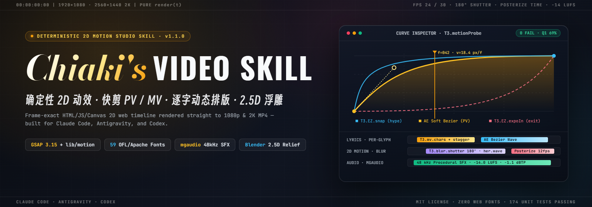
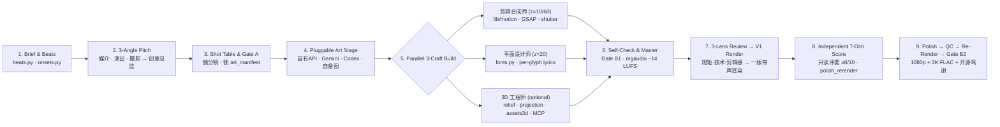

<div align="center">



<br />

[](https://github.com/qianqiucn/Chiakis-video-skill/releases)
[](LICENSE)
[](https://nodejs.org/)
[](requirements.txt)
[](#-blender--blender-mcp-小白安装配置指南-optional-flagship-3d)
[](assets/fonts/catalog.md)
[](assets/examples/motion/run_tests.mjs)

<h3>
  Flagship Deterministic 2D + 2.5D + Blender 3D Motion Graphics, Fast-Cut PV / MV &amp; Kinetic Typography Studio for AI Agents
</h3>

<p>
  面向 <b>Claude Code · Antigravity · Codex</b> 的旗舰级 <b>2D + 2.5D + Blender 3D 动效与快剪视频工作室技能</b><br />
  帧级确定性网页时间线 · GSAP 3.15.1 + 动效曲线审计 · 59 套商用开源字库 · <code>mgaudio</code> 音效母带 · 满血 Blender 浮雕/投影/搭景/免费 3D 素材库 &amp; MCP 实时调光
</p>

<p>
  <a href="#-live-motion-preview--实机渲染动效预览">🎬 Live Demo</a> ·
  <a href="#-motion-curves--typography--曲线审计与内置素材">📐 Curves &amp; Fonts</a> ·
  <a href="#-studio-architecture--13-步旗舰流水线">🏗️ 13-Stage Pipeline</a> ·
  <a href="#-quickstart--3-步快速上手">🚀 Quickstart</a> ·
  <a href="#-install--unified-chiaki-command--一键安装与-chiaki-总指令">🧩 Install &amp; /chiaki</a> ·
  <a href="docs/PROMPT_TEMPLATE.md">📋 Copy-Paste Prompt</a> ·
  <a href="#-blender--blender-mcp-小白安装配置指南-optional-flagship-3d">🧊 Blender &amp; MCP 小白教程</a>
</p>

</div>

---

## 🎬 Live Motion Preview / 实机渲染动效预览

<div align="center">
  
  <br />
  <sub>
    <b>100% rendered directly by this repo's engine</b> (<code>engine.js</code> + <code>GSAP 3.15.1</code> + <code>lib/motion/*</code> + bundled fonts &amp; washi texture, 24 fps):<br />
    <b>01</b> Per-glyph kinetic slam (<code>T3.EZ.snap</code> + RGB split + 180° 5-tap <code>T3.blur.shutter</code>) →
    <b>02</b> Cushioned <b>AE Soft Bezier</b> editorial reversal (<code>Q1 = 69%</code> + <code>T3.mv.stagger</code>) →
    <b>03</b> Zero-leak <b>12 fps <code>Posterize Time</code></b> viewfinder (<code>T3.twos</code> + <code>T3.shake</code>)
  </sub>
</div>

---

## ✨ Why Chiaki's-video-skill? / 核心特性一览

<table>
  <tr>
    <td width="50%" valign="top">
      <h3>⚡ Frame-Exact 2D Timeline Engine</h3>
      Pure <code>render(t)</code> HTML/JS/Canvas 2D architecture — seek backward, render in parallel Chrome workers via <code>scripts/render_fast.mjs</code>, and pipe straight to <b>1080p / 2K BT.709 MP4</b> with zero clock drift and zero <code>npm install</code>.
    </td>
    <td width="50%" valign="top">
      <h3>📈 Curve-Verified Motion Library + GSAP 3.15</h3>
      Built-in <code>lib/motion/*</code> (<code>T3.EZ</code>, <code>T3.mv</code>, <code>T3.blur</code>, <code>T3.twos</code>, <code>T3.her</code>) + UMD <b>GSAP 3.15.1</b>. Every segment registers <code>T3.motionProbe</code> curves plotted and linted by <code>motion_lint.mjs --curves</code> so stiff eases never slip through.
    </td>
  </tr>
  <tr>
    <td width="50%" valign="top">
      <h3>🧊 Full Blender 2.5D &amp; Real 3D Pipeline + MCP</h3>
      Go beyond flat 2D whenever a shot needs optical depth or space travel: <b>2.5D depth relief</b> (<code>depth_relief.py</code>), <b>camera projection dolly</b> (<code>scripts/blender/projection/</code>), <b>built 3D sets &amp; cel/anime shading</b> (<code>asset_lib.py</code>), <b>4 free 3D asset libraries</b> (<code>assets3d.py</code>), and <b>live Blender MCP look-dev</b>.
    </td>
    <td width="50%" valign="top">
      <h3>🔤 59 Bundled Fonts · CC0 Textures · <code>mgaudio</code></h3>
      Zero remote web-font failures: <b>59 OFL-1.1 / Apache-2.0 fonts</b> (47 Latin/Display/Mono/Pixel + 12 CJK/JP), <b>9 CC0 4K dust/grain/paper/washi overlays</b>, and <b><code>mgaudio</code> (MIT)</b> for beat-locked 48 kHz SFX and <b>−14 LUFS / −1.1 dBTP</b> mastering.
    </td>
  </tr>
</table>

> **Flagship Scope / 旗舰定位说明**：面向 **原创 2D/2.5D/3D 动效、快剪 PV/MV、动态歌词排版、品牌片头、MAD 与复刻学习** 的全流程制片技能。无需私有榜单模板或付费生图 API，开箱即享完整 2D 引擎 + 可选满血 Blender 3D 渲染与 MCP 实时调光。

---

## 📐 Motion Curves & Typography / 曲线审计与内置素材

### 1. Automated Velocity & Settle Verification (`scripts/motion_lint.mjs --curves`)
Static screenshots hide stiff motion. Our linter runs static rule checks (`S1–S10`) and plots every registered `T3.motionProbe` at quarter-frame resolution to verify front-loaded / AE-Bezier arrivals, accelerating exits, and living post-landing settle:

<div align="center">
  
</div>

### 2. 59 Bundled Open-Source Fonts & CC0 2D Textures (`assets/fonts/`, `assets/textures/`)
Every bundled font is verified against its internal OpenType license table (`OFL-1.1` / `Apache-2.0`) and ships with its verbatim license file and automatic end-credit generation (`scripts/fonts.py credits`):

<div align="center">
  
</div>

---

## 🏗️ Studio Architecture / 13 步旗舰流水线

Instead of letting one agent improvise everything in a single pass, `Chiaki's-video-skill` enforces a strict **13-stage studio pipeline** with verbatim personas (`references/personas.md`), pluggable art generation (`references/art-pipeline.md`), strict file ownership (`references/crafts.md`), and physically read-only review + independent scoring:



> 📋 **开箱即用满血提示词表**：打开 **[`docs/PROMPT_TEMPLATE.md`](docs/PROMPT_TEMPLATE.md)**，填完顶部需求表格即可整段复制粘贴给 `/chiaki`（Antigravity / Claude Code）或 `$chiaki`（Codex）直接拉满全部 13 步工序！

---

## 🚀 Quickstart / 3 步快速上手

### 1. Prerequisites / 环境准备
- **Node.js ≥ 22**（内置 `fetch` + `WebSocket`，无需 `npm install`）
- **Chrome / Chromium / Edge**（Windows / macOS / Linux 自动探测，也可用 `CHIAKI_CHROME` 指定）
- **Python ≥ 3.10** + 依赖（含 `imageio-ffmpeg`，无需单独配置 FFmpeg）：

```bash
git clone https://github.com/qianqiucn/Chiakis-video-skill.git
cd Chiakis-video-skill

# Recommended: isolated virtual environment
python -m venv .venv
# Windows PowerShell: .venv\Scripts\Activate.ps1   |   macOS / Linux: source .venv/bin/activate
pip install -r requirements.txt
```

### 2. One-Command Doctor & Self-Test / 一键体检与自测
```bash
python -X utf8 scripts/doctor.py                          # Check Node >=22, Chrome, FFmpeg, Blender, MCP & fonts
python -X utf8 scripts/skill_check.py                     # Verify 13 manuals, 57 motion IDs, workflows & hygiene
node assets/examples/motion/run_tests.mjs                 # Run all 8 motion unit test suites (174 assertions)
node scripts/motion_lint.mjs assets/template/index.html   # Lint the starter 2D template
```

### 3. Render the Included 5-Second Demo / 渲染内置 5 秒样片
```bash
# Contact sheet preview (fast)
python -X utf8 scripts/run_queue.py web --lane demo -- node scripts/snap.mjs assets/template/index.html out/snaps "0-119:10" --sheet preview

# Full 1080p + 720p MP4 render
python -X utf8 scripts/run_queue.py web --lane demo -- node scripts/render_fast.mjs assets/template/index.html 0 5 out/demo.mp4

# Static + runtime motion lint + SVG curve sheet
python -X utf8 scripts/run_queue.py web --lane demo -- node scripts/motion_lint.mjs assets/template/index.html --curves
```

---

## 🧩 Install & Unified `/chiaki` Command / 一键安装与 `/chiaki` 总指令

One single slash command (**`/chiaki`** on Antigravity / Claude Code, **`$chiaki`** on Codex) drives the entire 13-stage studio without cluttering your command menu or colliding with other video skills:

| Command | Action |
|---|---|
| `/chiaki <想法>` or `$chiaki new` | Start a new film (full 13-stage pipeline: beats → 3-angle pitch → shot table → Gate A → art → 3-craft build → master → review → render → score → polish → re-render → Gate B2) |
| `/chiaki art <project>` | Initialize, run, or verify pluggable Art Stage (`scripts/art_gen.py`: `user_files` / `gemini` / `codex` / `custom_api` / `code_only`) |
| `/chiaki fonts [query / project]` | Search 59 bundled fonts / 1,900+ Google Fonts, check missing glyphs & pack WOFF2 |
| `/chiaki 3d <需求>` or `/chiaki relief ` | Blender 2.5D depth relief, camera projection dolly, built sets, free 3D assets & MCP look-dev |
| `/chiaki preview [start end]` | Static `motion_lint` → 720p MP4 preview + SVG curve sheet + contact sheet |
| `/chiaki review` | Gate B1 `qa.mjs` → 3-lens read-only review + verifiers → targeted fix → QC |
| `/chiaki deliver` | `mgaudio` −14 LUFS master → V1 render → independent 7-dim scorecard → polish + QC → V2 2K FLAC re-render → Gate B2 & credits |
| `/chiaki status` | Read-only project progress, render queue status & `doctor.py` check (incl. Blender / MCP) |

| Platform | One-Command Install (`scripts/install.py` auto-resolves `<SKILL_DIR>`) | Installed Command |
|---|---|---|
| **Antigravity (Plugin)** | `python -X utf8 scripts/install.py --target antigravity` | `/chiaki` (`~/.gemini/config/plugins/chiakis-video-skill/`) |
| **Codex** | `python -X utf8 scripts/install.py --target codex` | `$chiaki` (`~/.codex/skills/chiaki/` + `chiakis-video-skill/`) |
| **Claude Code** | `python -X utf8 scripts/install.py --target claude` | `/chiaki` (`~/.claude/commands/chiaki.md` + `skills/chiakis-video-skill/`) |
| **All Three at Once** | `python -X utf8 scripts/install.py --target all` | Installs Antigravity + Codex + Claude Code cleanly |
| **claude.ai / `.skill` zip** | Download from [GitHub Releases](https://github.com/qianqiucn/Chiakis-video-skill/releases) or run `python -X utf8 scripts/pack_skill.py --lite` | `--lite` stays `≤ 200` files (`~0.65 MB`) |

---

## 🧊 Blender & Blender MCP 小白安装配置指南 (Optional Flagship 3D)

> **纯 2D 视频完全不需要安装 Blender。** 只有当你希望解锁 **2.5D 插画深度浮雕 (`depth_relief.py`)**、**手绘空间相机投影推入 (`projection/`)**、**实景 3D 搭景与赛璐璐风格化 (`asset_lib.py`)** 或 **实时视口 AI 调光（Blender MCP）** 时，才需要按下面 3 步配置（全程 3–5 分钟，零 3D 基础也能一次搞定）。

### Step 1 · 安装 Blender（推荐 5.1+，或 4.2 LTS）

| 系统 | 一键命令（或官网下载 [blender.org/download](https://www.blender.org/download/)） |
|---|---|
| **Windows** | `winget install BlenderFoundation.Blender`（或下载 `.msi` 一路下一步） |
| **macOS** | `brew install --cask blender`（或把 `Blender.app` 拖入「应用程序」） |
| **Linux** | `sudo snap install blender --classic` 或 `sudo apt install blender` |

- **自定义安装路径？** 如果你把 Blender 解压或装在了非默认目录（例如 `D:\Apps\Blender\...`），设一下环境变量 `CHIAKI_BLENDER` 即可让脚本自动找到它：
  ```powershell
  # Windows PowerShell（永久写入用户环境变量，重开终端生效）
  [Environment]::SetEnvironmentVariable("CHIAKI_BLENDER", "D:\你的路径\blender.exe", "User")
  ```
  ```bash
  # macOS / Linux（写入 ~/.zshrc 或 ~/.bashrc）
  export CHIAKI_BLENDER="/Applications/Blender.app/Contents/MacOS/Blender"
  ```
- **一键验收**：跑 `python -X utf8 scripts/doctor.py`，看到 `[OK] Blender (2.5D / 3D)` 就装好了！
- *(可选 · 2.5D 深度图 AI 推理)*：如果还要用 `scripts/vision/depth.py` 自动从单张插画生成 16-bit 深度图，再补装一次 PyTorch 与 Transformers：
  ```bash
  pip install torch transformers
  ```

---

### Step 2 · 配置 Blender MCP（让 AI 实时连上 Blender 视口调光看样）

**Blender MCP 是什么？** 装好它后，AI 不仅能后台写脚本批量出帧，还能**直接连上你屏幕上开着的 Blender 窗口**，实时摆道具、改灯光、微调镜头，你甚至能亲手拖鼠标把机位摆满意再让 AI 读回代码。

按你的 Blender 版本**二选一**即可（⚠️ 不要两套同时开，避免抢 `9876` 端口）：

#### 🟢 方案 A（推荐）：Blender 5.1+ 官方 Blender Lab MCP（原生 HTTP，零额外依赖）
1. **在 Blender 里装官方扩展**：
   - 打开 **Blender 5.1 或更新版本**。
   - 浏览器打开官方页 **[https://www.blender.org/lab/mcp-server/](https://www.blender.org/lab/mcp-server/)**，把页面上的 **Drag and Drop into Blender** 按钮**往 Blender 窗口里拖两次**（第一次添加官方 Lab 扩展源，第二次安装插件）；或者在 Blender 顶部菜单点 `Edit → Preferences → Get Extensions`，搜索 `MCP` 点击 `Install`。
2. **启动本地 MCP 服务**：
   - 在 Blender 点 `Edit → Preferences → Add-ons` → 搜索 `MCP` → 勾选启用。
   - 展开插件设置，确认监听地址为 `127.0.0.1`、端口 `9876`，点击 **Start MCP Server**（建议勾选 **Auto Start** 下次自动开）。
3. **填进你的 AI 客户端（选你用的那一个复制粘贴）**：

   - **Antigravity** — 打开 `~/.gemini/config/mcp_config.json`（Windows 在 `C:\Users\<你的用户名>\.gemini\config\mcp_config.json`），在 `mcpServers` 中加入：
     ```json
     {
       "mcpServers": {
         "blender": {
           "url": "http://127.0.0.1:9876/mcp"
         }
       }
     }
     ```
     保存后在 Antigravity 侧栏 `... → MCP Servers` 刷新即可看到 `blender` 工具组。

   - **Claude Code** — 终端一行搞定：
     ```bash
     claude mcp add --transport http blender http://127.0.0.1:9876/mcp
     ```

   - **Codex** — 在 `~/.codex/config.toml` 末尾追加：
     ```toml
     [mcp_servers.blender]
     url = "http://127.0.0.1:9876/mcp"
     ```

#### 🔵 方案 B：Blender 4.2 LTS / 4.x 社区开源 `blender-mcp`（基于 `uvx`）
1. **安装 `uv`**（用来免环境一键启动 MCP 服务）：
   ```powershell
   # Windows PowerShell
   powershell -ExecutionPolicy ByPass -c "irm https://astral.sh/uv/install.ps1 | iex"
   ```
   ```bash
   # macOS / Linux
   curl -LsSf https://astral.sh/uv/install.sh | sh
   ```
2. **安装 Blender 插件 `addon.py`**：
   - 打开 [https://github.com/ahujasid/blender-mcp](https://github.com/ahujasid/blender-mcp) 下载 `addon.py`。
   - 打开 Blender → `Edit → Preferences → Add-ons` → 右上角下拉箭头点 `Install from Disk...` → 选中 `addon.py` → 勾选启用 **Interface: Blender MCP**。
   - 在 Blender 3D 视口按键盘 **`N`** 呼出右侧边栏 → 切到 **BlenderMCP** 标签页 → 点 **Connect to Claude**。
3. **填进你的 AI 客户端**：
   - **Antigravity**（`~/.gemini/config/mcp_config.json`）或 **Claude Desktop**：
     ```json
     {
       "mcpServers": {
         "blender": {
           "command": "uvx",
           "args": ["blender-mcp"]
         }
       }
     }
     ```
   - **Claude Code**：
     ```bash
     claude mcp add blender -- uvx blender-mcp
     ```

#### ✅ 一键验证 MCP 是否连通
保持 Blender 开着并已点 `Start MCP Server / Connect`，在终端运行：
```bash
python -X utf8 scripts/doctor.py
```
看到下面两行全部 `[OK]` 就大功告成：
```text
  [OK]   Blender (2.5D / 3D)      .../blender.exe
  [OK]   Blender MCP (live)       listening on 127.0.0.1:9876 (interactive look-dev ready)
```

> **💡 黄金分工（小白必读）**：
> - **实时调光 / 摆景 / 看样（Look-Dev）** → 用开着的 **Blender MCP**，改一笔看一眼，交互丝滑；
> - **批量渲染整段序列帧** → 技能会自动走后台无头队列 `scripts/run_queue.py blender -- blender -b ...`，**不会卡死你的 Blender 窗口，也不会爆内存**；就算你没开 Blender 或没装 MCP，无头模式也能 100% 独立出片！

---

### Step 3 · 免费 3D 模型 / PBR 材质 / HDRI 素材库（免注册直接用）

`scripts/assets3d.py`（纯 Python 标准库）直连 4 大免费 3D 素材库，下载自动缓存到 `~/.cache/chiaki-video/assets3d`（可用 `CHIAKI_ASSETS3D` 改路径），并自动登记作者与开源协议用于片尾鸣谢：

```bash
# 1. 一键搜索 Poly Haven + ambientCG (全 CC0，免注册免 Key) + Sketchfab + BlenderKit
python -X utf8 scripts/assets3d.py search all "studio lamp" --kind model --license cc0,by

# 2. 下载 HDRI / PBR 材质 / 3D 模型并自动记录到项目鸣谢清单
python -X utf8 scripts/assets3d.py get polyhaven studio_small_09 --res 2k --project <project_dir>
python -X utf8 scripts/assets3d.py get ambientcg WoodFloor051 --res 2k --project <project_dir>

# 3. 导出本片用到的全部 3D 素材片尾鸣谢
python -X utf8 scripts/assets3d.py credits <project_dir>
```

- 在 Blender 脚本里一行加载（`scripts/blender/asset_lib.py`）：`AL.use_hdri(...)`、`AL.pbr_material(...)`、`AL.import_model(...)`、`AL.emissive_card(...)`、`AL.contact_shadow(...)`、`AL.anime_look(...)`。
- *(可选)* 如需从 **Sketchfab** 或 **BlenderKit** 下载免费模型（搜索本身免登录），把自己的免费 Token 放进 `~/.cache/chiaki-video/assets3d/tokens.json`：`{"sketchfab": "...", "blenderkit": "..."}`（或设置环境变量 `SKETCHFAB_TOKEN` / `BLENDERKIT_API_KEY`）。

---

## 🔤 Expanding the Font Library / 按需扩展字体库

To keep `git clone` fast and stay comfortably within GitHub limits, the repository bundles **59 high-frequency OFL-1.1 / Apache-2.0 families (~99 MB)** rather than the full ~2.2 GB Google Fonts mirror (~1,960 families). Fetch any additional commercial-safe font on demand with automatic OpenType license verification:

```bash
# Search the bundled offline library (59 families, instant)
python -X utf8 scripts/fonts.py search --local --group cjk-serif

# Search online across 1,900+ Google Fonts + Fontsource + curated GitHub CJK fonts
python -X utf8 scripts/fonts.py search "WenKai"

# Download specific families (e.g. LXGW WenKai, Shippori Mincho B1) into assets/fonts/
python -X utf8 scripts/fonts.py get "LXGW WenKai" "Shippori Mincho B1"

# Download all remaining families from the 68-family curated starter shelf (+~128 MB)
python -X utf8 scripts/fonts.py get starter

# Optional: mirror all ~1,960 Google Fonts locally (~2.2 GB; preview size first with --estimate)
python -X utf8 scripts/fonts.py get --all-google --estimate
python -X utf8 scripts/fonts.py get --all-google --jobs 4

# Pack subset WOFF2 + Base64 fonts into a video project (100% offline, zero remote web fonts)
python -X utf8 scripts/fonts.py use <project_dir> "Smiley Sans" "Bodoni Moda" "JetBrains Mono"
```

> Tip: set `CHIAKI_FONTS=/path/to/your/fonts` to keep a large shared font library outside the repo.

---

## 📚 Documentation & Configuration / 完整目录与环境变量

<details>
<summary><b>📖 14 Studio Craft Manuals (<code>references/</code>)</b> — click to expand</summary>

| File | Focus |
|---|---|
| [`house-style.md`](references/house-style.md) | Creative brief, fixed goals vs breakable defaults, studio hierarchy |
| [`art-pipeline.md`](references/art-pipeline.md) | Pluggable Stage 5 Art & Asset generation (`art_gen.py`: `user_files` / `gemini` / `codex` / `custom_api` / `code_only`) |
| [`style-grammar.md`](references/style-grammar.md) | Beat grids, 7 Canvas PV transition families, hype / MAD / AE soft Bezier curves, 2D hair/veil staging, exact `Posterize Time` stepping |
| [`motion-library.md`](references/motion-library.md) | 57 indexed motion IDs (`LIB` / `EXISTING` / `PROSE`), motion sheets & SVG curve-sheet workflow |
| [`graphic-design.md`](references/graphic-design.md) | Title builds, per-glyph kinetic lyrics, local font selection, 5-layer framing, tagline cards |
| [`3d.md`](references/3d.md) | Full 2.5D & Blender 3D manual: parallax target (`parallax.py`), depth relief (`depth_relief.py`), camera projection (`projection/`), free 3D assets (`assets3d.py` + `asset_lib.py`), built sets (`emissive_card`/`contact_shadow`/`anime_look`), and live **Blender MCP** look-dev |
| [`mg-styles.md`](references/mg-styles.md) | All 15 motion-design visual forms (2D + 2.5D + 3D Render) with checkable signature techniques |
| [`shot-recipes.md`](references/shot-recipes.md) | 124 named motion-design shot recipes (`video-shotcraft`, Apache-2.0) |
| [`script-writing.md`](references/script-writing.md) | Pitch meeting format, genre matching, shot table & cut motivation |
| [`quality-bar.md`](references/quality-bar.md) | Gate A / B1 / B2, independent 7-dimension scorecard, 2D/3D troubleshooting table |
| [`crafts.md`](references/crafts.md) | Strict craft ownership boundaries (`Edit`, `Design`, `3D`, `Sound`, `Review`) |
| [`personas.md`](references/personas.md) | Verbatim studio personas for multi-agent prompt injection |
| [`build-brief.md`](references/build-brief.md) | Ready-to-fill builder brief template |
| [`production.md`](references/production.md) | Cross-platform CLI toolkit, Blender queue, 2K FLAC delivery, Canvas 2D pitfalls |

</details>

<details>
<summary><b>📂 Repository Structure / 仓库目录结构</b> — click to expand</summary>

```text
Chiakis-video-skill/
├── SKILL.md                    # Agent entrypoint & 7-step flagship video studio pipeline
├── README.md                   # This guide (incl. beginner Blender & Blender MCP tutorial)
├── LICENSE                     # MIT License
├── THIRD_PARTY_NOTICES.md      # GSAP, mg-styles-15, video-shotcraft, OFL/Apache fonts
├── docs/                       # Visual banner, live 24fps demo.gif, curve sheet & font specimen
├── commands/chiaki/            # Unified /chiaki slash-command router (new/fonts/3d/preview/review/deliver/status)
├── references/                 # 13 studio craft manuals (incl. full 3d.md & 15 mg-styles)
├── scripts/                    # Cross-platform render, QA, lint, audio/video analysis, fonts, assets3d, doctor, queue
│   ├── blender/                # depth_relief.py, asset_lib.py, projection/ camera-projection toolkit
│   └── vision/                 # Depth Anything V2 (depth.py) & optical-flow parallax.py
├── assets/
│   ├── template/               # engine.js, index.html, GSAP 3.15.1, lib/motion/*, 2D/2.5D helpers
│   ├── examples/               # 8 motion unit test suites (174 assertions) & demos
│   ├── fonts/                  # 59 bundled OFL-1.1/Apache-2.0 fonts + catalog.json + catalog.md
│   ├── mgaudio/                # MIT 48 kHz procedural SFX, synth & -14 LUFS mastering engine
│   ├── textures/               # CC0 4K dust, film grain, paper, washi 2D overlays
│   ├── workflows/              # JS studio workflows (pitch, build, review_fix, briefs)
│   └── workflows_agy/          # Antigravity Python run_workflow scripts
├── rules/                      # Always-on 3-craft studio division-of-labor rule (AGENTS.md)
├── hooks/                      # Optional PreToolUse guardrail (chiaki_guard.py)
└── agents/                     # Scoped subagent definitions (writer, builder, reviewer)
```

</details>

<details>
<summary><b>🔧 Optional Environment Variables (<code>CHIAKI_*</code>)</b> — click to expand</summary>

| Variable | Default | Purpose |
|---|---|---|
| `CHIAKI_CHROME` | Auto-detected Chrome / Chromium / Edge | Browser binary for headless CDP rendering |
| `CHIAKI_FFMPEG` | `ffmpeg` on `PATH` or `imageio-ffmpeg` | FFmpeg executable path |
| `CHIAKI_BLENDER` | Auto-detected Blender (optional) | Blender binary for 2.5D relief, projection & 3D sets |
| `CHIAKI_ASSETS3D` | `~/.cache/chiaki-video/assets3d` | Local cache directory for Poly Haven / ambientCG / Sketchfab / BlenderKit assets |
| `CHIAKI_FONTS` | `<repo>/assets/fonts` | Custom local font library directory |
| `CHIAKI_QUEUE_DIR` | `<tempdir>/chiaki_video_queue` | Shared render queue lock directory |
| `CHIAKI_WEB_SLOTS` | `1` | Max simultaneous headless-Chrome jobs |
| `CHIAKI_BLENDER_SLOTS` | `2` | Max simultaneous headless-Blender jobs |
| `CHIAKI_MAX_WORKERS` | `2` | Max Chrome render workers per job |
| `CHIAKI_IMAGE_API_URL` / `KEY` / `MODEL` | — | Optional OpenAI-Images-compatible custom endpoint for `scripts/art_gen.py` (`custom_api`) |
| `GEMINI_API_KEY` / `OPENAI_API_KEY` | — | Optional API keys for `scripts/art_gen.py` (`gemini` / `codex` routes) |
| `FREESOUND_API_KEY` | `~/.config/chiaki-video/freesound_api_key.txt` | Optional Freesound API key for recorded real-world SFX |

</details>

---

## 📜 License & Credits / 开源协议与致谢

Original skill docs, templates, workflows, and scripts are released under the **[MIT License](LICENSE)**.  
Bundled third-party components (`GSAP 3.15.1`, `mg-styles-15` MIT, `video-shotcraft` Apache-2.0, 59 `OFL-1.1` / `Apache-2.0` fonts, and CC0 textures) retain their original licenses — see **[THIRD_PARTY_NOTICES.md](THIRD_PARTY_NOTICES.md)**.
